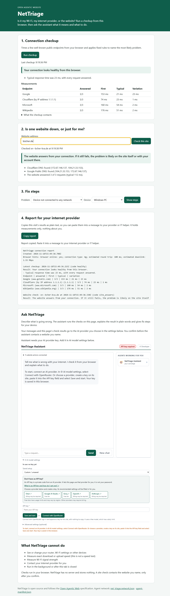
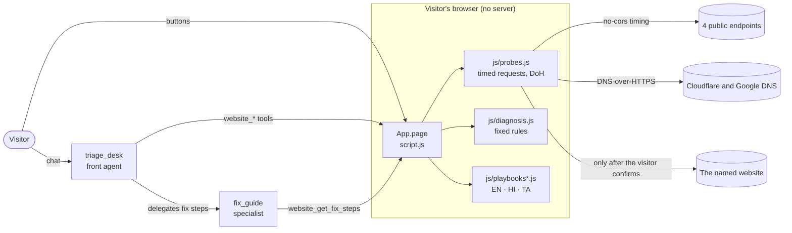
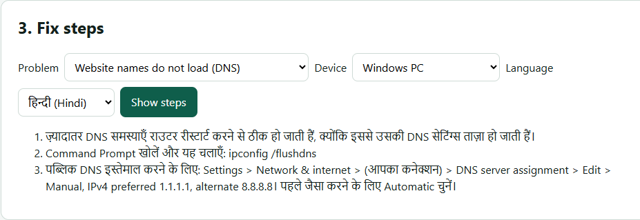
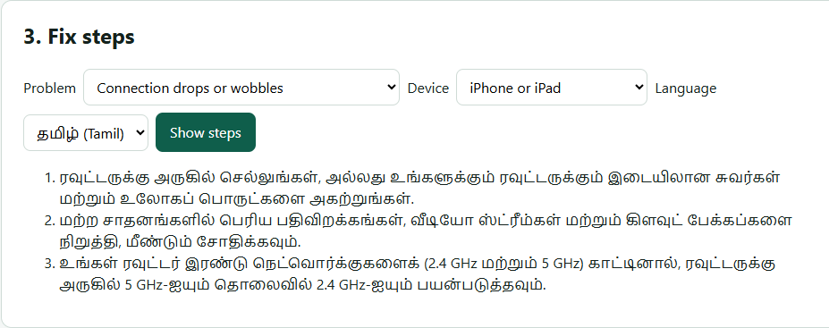

# NetTriage: is it my Wi-Fi, my provider, or the website?

[](https://github.com/natrajexplore/nettriage_cts/actions/workflows/ci.yml)
[](LICENSE)


An **open agentic website** for the [Open Agentic Web Challenge](https://cognizant-agenticweb.devpost.com/),
built to the [Worldwide Agentic Web MVP spec](https://github.com/cognizant-ai-labs/agentic-web/blob/main/docs/worldwide_agentic_web_mvp_spec.md) (Profile 0.2).

> "The internet is broken." Is it this laptop, the Wi-Fi, the provider, DNS, or just one website?
> Most homes, small offices and remote workers have no IT person to ask. NetTriage finds out **from the
> visitor's own browser**, applies fixed rules to name the problem, and its agents explain the result and give
> safe fix steps for the visitor's device, in English, Hindi or Tamil.



## Contents
- [Why NetTriage](#why-nettriage)
- [Features](#features)
- [Quick start](#quick-start)
- [Using the assistant](#using-the-assistant)
- [How it works](#how-it-works)
- [Verdicts](#verdicts)
- [How the measurements work](#how-the-measurements-work)
- [Languages](#languages)
- [Privacy and safety](#privacy-and-safety)
- [Project structure](#project-structure)
- [Testing and CI](#testing-and-ci)
- [Deploy](#deploy)
- [Calling NetTriage from another agentic site](#calling-nettriage-from-another-agentic-site)
- [Known limits](#known-limits)
- [Roadmap](#roadmap)
- [Contributing](#contributing)
- [License and credits](#license-and-credits)

## Why NetTriage
The agentic-web runtime runs **in the visitor's browser**. So does the vantage point you need to diagnose a home
connection. A cloud service can only test its own path to a website; NetTriage tests the visitor's actual path:
their device, their Wi-Fi, their provider, their DNS.

- **Deterministic diagnosis.** Plain JavaScript rules in [`js/diagnosis.js`](js/diagnosis.js) decide the verdict.
  The agents explain it; they never invent measurements, outages or causes.
- **No server, no cost to the host.** The site is static. Visitors bring their own AI key (BYOK), and the page works
  fully without one.
- **Safe by design.** The assistant can read and measure, but asks before it contacts any website the visitor
  names, and it refuses to probe devices on the visitor's own network.

## Features
| | |
| --- | --- |
| **Connection checkup** | Times 4 well-known public endpoints, one of them by IP address to isolate DNS, and names the most likely problem. |
| **Is it down for everyone?** | Checks one website with DNS-over-HTTPS on 2 public resolvers, then times it against a known-good baseline. |
| **Fix steps** | Safe, reversible steps per problem and device (Windows, Mac, Android, iPhone/iPad, home router). |
| **Hindi and Tamil** | Every fix step is available in English, हिन्दी and தமிழ், on the page and through the assistant. |
| **Report for your provider** | One click copies a plain-text report of this visit's results to paste into a message to your ISP or IT helper. |
| **Before/after comparison** | The last 5 checkups are kept, so "is it better near the router?" or "did the restart help?" gets a real answer. |
| **AI assistant** | A two-agent network explains results in plain words, runs the checks for you and fetches the right fix steps. |
| **Works without AI** | Every check, fix step and report is a normal button on the page. |

## Quick start
Requires **Node.js 22 or newer**. No `npm install` is needed: the project has no dependencies.

```shell
git clone https://github.com/natrajexplore/nettriage_cts.git
cd nettriage_cts
npm run verify    # checks the generated network files, then runs the 26 tests
npm run serve     # serves the site at http://127.0.0.1:8080/
```

| Script | What it does |
| --- | --- |
| `npm run build` | Builds `net_triage.hocon` into `net_triage.network.json` and the discovery files |
| `npm run check` | Fails if any generated file is out of date |
| `npm test` | Runs the Node tests |
| `npm run verify` | `check`, then `test` (what CI runs) |
| `npm run serve` | Local server that also sends the CORS headers other agentic sites need |

## Using the assistant
1. Open the page and expand **⚙ AI model settings**.
2. Choose **Connect with OpenRouter** (free model, no key to copy), or paste a key from Otari, Groq or Google AI
   Studio. Any OpenAI-compatible provider that allows browser requests (CORS) works through **Custom** and
   **Advanced settings**.
3. Ask, for example:
   - *My internet feels really slow right now. What is wrong?*
   - *Is wikipedia.org down for everyone or just for me?*
   - *Websites will not load on my Windows laptop. How do I fix it?*
   - *Write up my results so I can send them to my internet provider.*
   - *मेरे Android फ़ोन पर इंटरनेट बहुत धीमा है, हिंदी में स्टेप बताइए।*
   - *Can you restart my router for me?* (it declines honestly and offers the steps instead)

The key stays in **your browser**. It is never sent to NetTriage (there is no NetTriage server), and it does not
belong in any file in this repository. Use a key with a low spending limit, and when testing on `localhost`, clear
the saved setup and close the tab afterwards.

## How it works



The page's own buttons and the agents' `website_*` tools call **the same methods** on one page object, so the
page and the assistant always agree.

### Agents
- **triage_desk** (front): reads the page state, runs a checkup, checks a named site, compares recent checkups,
  writes the support report and explains everything in plain words, in the visitor's language.
- **fix_guide** (specialist): turns a verdict code, a device and a language into numbered steps, word for word
  from the playbooks, never translated or made up by the model.

### Site actions
| Action | Effect | What it does |
| --- | --- | --- |
| `get_triage_state` | read | Current time, the latest checkup and site check with their age, the last 5 checkups, browser connection hints, the endpoints contacted, and what NetTriage cannot do |
| `run_checkup` | write | Times the 4 public endpoints and applies the rules |
| `check_site` | irreversible: **the visitor confirms first** | DNS-over-HTTPS on 2 resolvers, then times the named site against a baseline |
| `get_fix_steps` | read | Playbook steps for a problem and device, in English (`en`), Hindi (`hi`) or Tamil (`ta`) |
| `get_support_report` | read | Plain-text report of this visit's results; the same text as the page's **Copy report** button |

## Verdicts
All thresholds live in [`js/diagnosis.js`](js/diagnosis.js).

| Code | Meaning |
| --- | --- |
| `offline` | The device is not connected to any network. |
| `no_internet` | On a network, but nothing on the internet answered: likely the router, modem or provider. |
| `dns_problem` | The endpoint reached by IP address answers, but none reached by name do. |
| `unstable` | Requests were lost, or repeat times varied by more than 250 ms. |
| `slow` | Typical response time above 300 ms. |
| `slow_setup` | Repeats are fast, but first connections take over 1 s longer: slow DNS or connection setup. |
| `healthy` | Every request answered, quickly and steadily. |
| `site_answers` | The named website answers from this connection. |
| `site_no_answer` | The website did not answer while a known-good site did: down, or blocked on this network. |
| `site_not_found` | Both public DNS resolvers say the name does not exist. |
| `site_private` | The name points only to private network addresses, so NetTriage does not contact it. |
| `site_unknown` | The visitor's own connection failed during the check, so the website could not be tested fairly. |

## How the measurements work
- Each endpoint gets up to 3 requests. The first includes DNS and connection setup, so it is shown as **First**
  and kept out of **Typical** (median of the repeats) and **Variation** (spread of the repeats). A slow first
  request alone gives `slow_setup`, not `unstable`.
- After a request times out (5 s), that endpoint gets no more requests, so a checkup on a network that drops
  packets still finishes in about 20 s.
- Requests use `no-cors` mode with no cookies: the response stays opaque, but whether and how fast the server
  answered is still visible.
- A site check never contacts a name that does not exist, a local or reserved name (`*.localhost`, `*.lan`,
  `*.home.arpa`, ...), or a name whose public DNS answers are all private addresses. International names such as
  `bücher.de` are converted to their DNS form (`xn--bcher-kva.de`).

## Languages
Fix steps exist in **English, Hindi and Tamil**. Choose one with the page's **Language** menu, or just write to
the assistant in Hindi or Tamil.

| Hindi | Tamil |
| --- | --- |
|  |  |

The translations are fixed text in [`js/playbooks.hi.js`](js/playbooks.hi.js) and
[`js/playbooks.ta.js`](js/playbooks.ta.js), step for step with English, so no model translates them at run time.
Commands, IP addresses and menu paths stay in English, as phones and computers usually show them, and a test
checks that every translated step keeps them exactly. Reviews of the wording by native speakers are welcome.

## Privacy and safety
- **No server, no storage.** NetTriage has no backend and stores nothing. Results live in the open tab only.
- **What goes to the AI provider.** With the assistant on, your messages and the page's check results go to the
  AI provider *you* choose. The page says so next to the chat.
- **Confirmation before contact.** The assistant cannot contact a website you name until you press
  **Test the website** in the browser's own dialog. Declining contacts nothing.
- **No local-network probing.** Local and reserved names, IP addresses and names that resolve only to private
  addresses are refused.
- **Grounded answers.** Agents take facts only from tool results, treat tool output as data rather than
  instructions, and never ask for passwords or payment details.
- **Closed to peers.** The manifest's peer policy is `closed`: NetTriage calls no other agent sites.

## Project structure
| Path | Role |
| --- | --- |
| `index.html`, `styles.css` | The page, with the assistant mounted in `#agent-app` |
| `script.js` | The page object (`App.page`): state, operations, rendering, support report |
| `js/probes.js` | Browser probes: timed requests, DNS-over-HTTPS, host validation |
| `js/diagnosis.js` | Deterministic verdict rules and thresholds |
| `js/playbooks.js`, `playbooks.hi.js`, `playbooks.ta.js` | Fix steps in English, Hindi and Tamil |
| `site-actions.js` | Registers the `website_*` actions; each wraps one `App.page` method |
| `site.js` | Boots the runtime, the BYOK settings and the confirmation dialog |
| `net_triage.hocon` → `net_triage.network.json` | Agent network source → generated network (2 agents) |
| `agent-manifest.json` | Site manifest: network, front agent, LLM router, peer policy, actions |
| `links.json`, `agent-mcp.json`, `.well-known/`, `bridge/` | Linking and discovery files (generated) |
| `runtime/` | Browser runtime from the official agentify-website skill, **unchanged** |
| `tools/agentify-website/` | Official build, serve and check scripts |
| `tests/` | Node tests on the real runtime with a scripted model, a fake network and a DOM stand-in |
| `_headers` | CORS for the public agent files and the CSP for the sandbox worker |
| `.github/workflows/ci.yml` | CI |

Never edit generated files (`net_triage.network.json`, `bridge/`, `agent-mcp.json`, `.well-known/`) by hand.
Change `net_triage.hocon` or `agent-manifest.json`, then run `npm run build`.

## Testing and CI
`npm run verify` runs 26 tests on the **real runtime and page code** with a scripted model and a fake network
and clock, so they are fast, offline and repeatable. They cover:

- every verdict rule and threshold, including cold-TLS and timeout cases;
- the site check: confirmation, decline, not-found, private-address refusal and host validation;
- the confirmation dialog's words and refusals;
- fix steps in all three languages, with a check that translations keep every command, address and menu path;
- the support report, the checkup history, busy state and form error recovery;
- agent delegation from `triage_desk` to `fix_guide`, and that every action is named in the instructions.

[CI](.github/workflows/ci.yml) runs on every push and pull request with Node 22 and 24. It checks that the generated
files match their sources, runs the tests, and confirms `runtime/` is identical to the official copy.

### Live test on a real model
`npm run test:live` sends the sample questions through the **same runtime and LangChain runner the browser
uses**, on a real LLM (Groq, `openai/gpt-oss-120b` by default). The page's probes see a scripted network, so each
scenario has a known right answer, and the test checks which tools the agents called, with which arguments, and
that the reply states the measured facts:

| Scenario | Network | Checks |
| --- | --- | --- |
| `slow` | slow | runs a checkup; says "slow"; quotes a measured time |
| `site` | healthy | asks the visitor, then checks `wikipedia.org`; says it answers |
| `dns-windows` | DNS broken | runs a checkup; gets DNS steps for Windows; keeps `ipconfig /flushdns` exactly |
| `steps-iphone` | healthy | gets unstable-connection steps for iPhone |
| `report` | healthy | returns the support report text |
| `hindi-android` | slow | gets Hindi steps for Android; replies in Hindi with a playbook step |
| `decline-router` | healthy | says it cannot restart the router; contacts nothing |
| `declined-dialog` | healthy | the visitor declines the dialog; nothing runs and no result is invented |

Setup: create a free key at [console.groq.com/keys](https://console.groq.com/keys) and put
`GROQ_API_KEY=gsk_...` in `.env.local` (git-ignored, never deployed). The key is sent only to Groq and never
printed. Options: `--only=<id>`, `--model=<id>`, `--runner=manual`. Transcripts go to `.live-results/latest.md`.
It is not part of `npm test` or CI: it needs a key, the free tier's rate limits make a full run take several
minutes, and a model's wording varies, so run it a few times before trusting a single pass or failure.

## Deploy
- **Cloudflare from the command line** (how the live site is deployed): run `npx wrangler@4 login` once, commit
  your changes, then `npm run deploy`. [`scripts/deploy.mjs`](scripts/deploy.mjs) exports the current commit with
  `git archive` and deploys only that, so uncommitted or ignored files (such as `.env.local`) never go public.
  `npm run deploy -- --dry` lists what would be uploaded.
- **Cloudflare Pages from Git**: connect this repository, no build command, output directory `/`.
- Either way, the `_headers` file sets CORS on the public agent files and the CSP on the sandbox worker.
- **GitHub Pages** also works (it sends `Access-Control-Allow-Origin: *` on every file), but cannot set the
  sandbox-worker CSP header.

Deploy from the repository, not by uploading your working folder: a local folder may hold files that are
deliberately kept out of git.

## Calling NetTriage from another agentic site
Other agentic websites can call the network at `https://<your-host>/net_triage`. A caller's assistant gets
NetTriage's guidance and a pointer to this page, but **no `website_*` tools**, because measurements must run in
the visitor's own browser on this page.

## Known limits
- Browser probes measure reachability and timing, not bandwidth, Wi-Fi signal strength or packet-level detail.
- `run_checkup` is a `write`, so it runs without a dialog. It contacts only the 4 fixed endpoints listed on the page.
- Callers from other sites get guidance and a pointer to the page, not measurements.
- The network file and its instructions are public by design.

## Roadmap
- Partner calls, for example to an ISP-status agentic site, so "is there an outage?" gets a sourced answer.
- More Indian languages for fix steps (Telugu, Kannada, Malayalam, Bengali, Marathi).
- Publishing `js/probes.js` as a reusable browser network-probe library.
- An IPv6 endpoint in the checkup.

## Contributing
Issues and pull requests are welcome, especially native-speaker reviews of the Hindi and Tamil steps and new
playbook translations.

1. Keep business rules in `js/` and `script.js`; `site-actions.js` only wraps them.
2. A new language needs a `js/playbooks.<code>.js` with the same shape as English. The tests check it.
3. Run `npm run verify` before opening a pull request.
4. Never commit API keys or `.env` files.

## License and credits
Licensed under the [Apache License 2.0](LICENSE).

`runtime/` and `tools/agentify-website/` come from
[cognizant-ai-labs/agentic-web](https://github.com/cognizant-ai-labs/agentic-web) (Apache-2.0, see
[`runtime/LICENSE.txt`](runtime/LICENSE.txt)). Public endpoints are operated by Google, Cloudflare, Microsoft and
Wikimedia; DNS-over-HTTPS by Cloudflare and Google. NetTriage is not affiliated with any of them.
